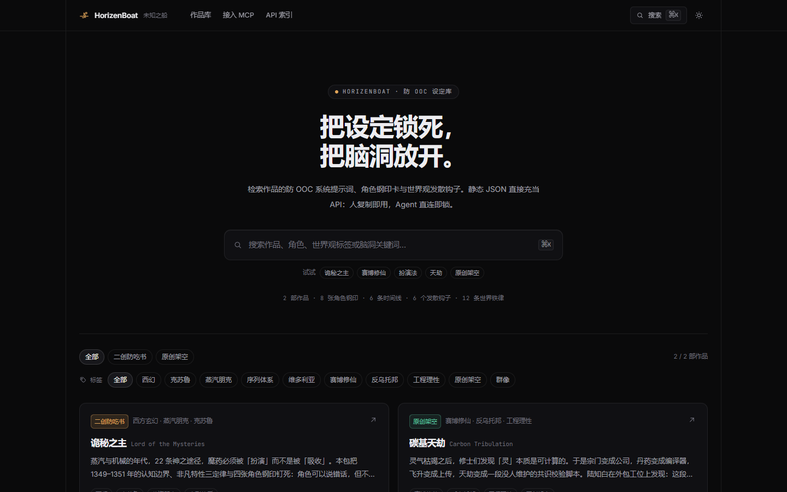

# HorizenBoat · 未知之船

**把设定锁死，把脑洞放开。**

[](https://github.com/yangzihao684-star/horizenboat/actions/workflows/ci.yml)
[](https://horizenboat.online)
[](web/public/api/v1/index.json)
[](mcp-server/server.py)
[](#版权)

一个轻量的**内容二创设定平台**，加一个控制力很强的 MCP Server。

- **站**：检索作品的防 OOC 系统提示词、角色钢印卡、世界观发散钩子；切时间线看边界变化；一键合成可以直接粘给任意 AI 的提示词。
- **数据**：没有数据库、没有后端。`web/public/api/v1/` 下的静态 JSON 就是 API。
- **Agent**：`mcp-server/server.py` 单文件 MCP Server，负责锁时间线、审吃书、逼发散。



## 目录

- [为什么值得看](#为什么值得看)
- [三个核心概念](#三个核心概念)
- [内置作品](#内置作品)
- [一键交付](#一键交付)
- [MCP Server](#mcp-server)
- [架构](#架构)
- [本地开发](#本地开发)
- [部署](#部署)
- [贡献](#贡献)
- [版权](#版权)

## 为什么值得看

绝大多数"角色设定"文档写的是**性格**，而 AI 写歪角色往往不是因为性格，是因为**他知道了不该知道的事**。

HorizenBoat 把每部作品拍成一张**时间闸门**：

- 他在这一刻**知道什么**（knowledge boundaries）
- 他这一刻**能打到什么程度**（power ceiling）
- 哪些事**还没发生**（forbidden events，带触发词）

切换时期，整页边界、黑名单、可用台词一起换。MCP 里锁定的也是这套东西。

## 三个核心概念

### 1. 时间线闸门

不按卷切，按**角色知道什么**切。一个好的时期划分要能回答：此刻他的战力上限是什么？他现在还不知道哪件大事？哪些情节现在写就是吃书？

### 2. 角色钢印卡

六件套：核心驱动力、性格内核、语言习惯、称呼矩阵、台词锚点、绝对禁止。

台词分两类，这个区分是刻意的：

| 类型 | 含义 |
| --- | --- |
| `canon` | 正典原句，有出处才用 |
| `style` | 按角色语域仿写，对齐语气，**不冒充原文** |

防 OOC 需要的是**语域**，不是背诵。

### 3. 关键词就是审查引擎的扳机

每条铁律、每条黑名单、每条 OOC 禁忌都带 `keywords` / `triggers`。它们同时被两处使用：

1. MCP 的 `audit_plot_ooc` 拿它做交叉比对，命中即报，附命中证据和改法
2. `npm run check:api` 强制它非空——防止有人加了铁律却忘了加触发词，导致审查静默失效

## 内置作品

| work_id | 作品 | 类型 | 为什么选它 |
| --- | --- | --- | --- |
| [`lord-of-the-mysteries`](web/public/api/v1/works/lord-of-the-mysteries.json) | 诡秘之主 | 二创防吃书 | 序列体系 + 扮演法 + 三定律，天生适合演示"提前知道就吃书" |
| [`carbon-tribulation`](web/public/api/v1/works/carbon-tribulation.json) | 碳基天劫 | 原创 · 赛博修仙 | 灵气＝算力，天劫＝共识校验。全部原创，供自由发散 |
| [`echo-loop`](web/public/api/v1/works/echo-loop.json) | 回声循环 | 原创 · 无限流 | 角色位 + 结局收敛律：规则怪谈类型的防 OOC 范本 |

三部分数据包合计：**12 位角色 · 9 条时间线 · 18 条世界铁律 · 9 个发散钩子**。

## 一键交付

详情页右侧的交付面板由「当前时间线 + 勾选角色」实时合成：

| 动作 | 产出 |
| --- | --- |
| 复制 System Prompt | 角色宪章：0 原则 / 1 铁律 / 2 时间线 / 3 钢印 / 4 文风 / 5 协议 / 6 自检表 |
| 预览 | 支持「排版 / 源码」两视图；复制的一律是原始 Markdown |
| 复制调用指令 | `lock_canon_context(work_id=…, timeline_id=…, active_characters=[…])` |
| 复制 MCP 配置 | 直接粘进 Claude Desktop / Cursor / Cline |

## MCP Server

| 工具 | 一句话 |
| --- | --- |
| `search_horizonboat` | 找作品、角色、标签、钩子 |
| `lock_canon_context` | 锁铁律 + 时间线 + 角色钢印，末尾附 `GUARDRAIL DIRECTIVE`（R1–R6） |
| `audit_plot_ooc` | 动笔前撞设定，返回 `BLOCK / REVISE / PASS` 与逐条改法 |
| `spark_world_divergence` | 三阶蝴蝶效应：规则碰撞 → 势力反弹 → 生态异变 |

外加两个 prompt（`hb-fanfic` / `hb-brainstorm`）和 `horizenboat://` 资源。

真实输出见 [`examples/`](examples/)——一段"看着挺爽"的大纲被拆成 2 处硬冲突 + 1 处越阶：

```
裁决：打回重写（存在硬冲突）　硬冲突 2 · 需修正 1
1. ✗ 违反世界铁律：角色位不可更换   命中证据：「无视角色位」
2. ✗ 角色 OOC：沈雾 / 开挂式破局     命中证据：「无视角色位」
3. △ 疑似越阶：一拳打穿车门
```

### 接入

```json
{
  "mcpServers": {
    "horizenboat": {
      "command": "python",
      "args": ["/path/to/horizenboat/mcp-server/server.py"],
      "env": { "HORIZENBOAT_API_URL": "https://horizenboat.online/api/v1" }
    }
  }
}
```

环境变量：`HORIZENBOAT_API_URL`（可指向 `file://` 或本地目录）、`HORIZENBOAT_CACHE_TTL`（默认 300）、`HORIZENBOAT_TIMEOUT`。

## 架构

```
        ┌──────────────────────────────────┐
        │   web/public/api/v1/*.json       │   唯一数据源（静态、无数据库）
        └───────────────┬──────────────────┘
            ┌───────────┴────────────┐
   ┌────────▼─────────┐     ┌────────▼─────────────┐
   │  静态站点         │     │  horizenboat-mcp     │
   │  搜索 / 时间线 /  │     │  4 tools · 2 prompts │
   │  钢印 / 提示词合成 │     │  TTL 缓存 · 单文件   │
   └────────┬─────────┘     └────────┬─────────────┘
            │                        │
   Cloudflare Pages           任意 MCP 客户端
   horizenboat.online         Claude / Cursor / Cline
```

## 本地开发

```bash
# 站点
cd web && npm install && npm run dev      # http://localhost:5173

# 数据校验（改过 JSON 必跑）
npm run check:api

# MCP Server
pip install -r mcp-server/requirements.txt
HORIZENBOAT_API_URL=web/public/api/v1 python mcp-server/server.py --selftest
python mcp-server/smoke_test.py
```

## 部署

站点是纯静态产物（`web/dist`），直接丢任何 CDN。当前生产环境：Cloudflare Pages + 自定义域名 `horizenboat.online`。

```bash
npm --prefix web run build
npx wrangler pages deploy web/dist --project-name horizenboat
```

仓库里也带了 `scripts/publish.ps1`（建仓 / 部署 / 绑域名 / 发 PyPI）和 `docs/DEPLOY.md`（含 GitHub Pages 备选方案）。

## 贡献

最有价值的贡献是**加一部作品**。规范在 [CONTRIBUTING.md](CONTRIBUTING.md)：字段速查、`keywords` 怎么写、时间线怎么切、我们会看什么。

快速开始：

```bash
cp examples/work.template.json web/public/api/v1/works/your-work-id.json
# 填完，登记到 index.json，然后：
cd web && npm run check:api
```

## 版权

- 站点与 MCP Server 代码：MIT
- 设定摘要与原创世界观：CC BY-NC-SA 4.0
- 《诡秘之主》相关角色与设定版权归原作者**爱潜水的乌贼**及出版方所有；本站仅作同人写作的连续性校验，不包含原文正文
